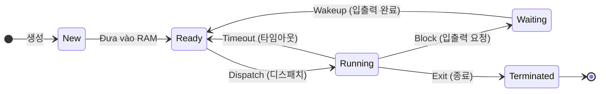

# 운영체제 아키텍처, 프로세스 관리 및 CPU 스케줄링 (Kiến trúc hệ điều hành, Quản lý tiến trình, Điều phối CPU & Bế tắc Deadlock)

## 학습 목표 (Mục tiêu)
- Nắm vững 4 chỉ số hiệu năng đánh giá hệ điều hành: Thông lượng (**Throughput**), Thời gian phản hồi (**Turnaround Time**), Tính sẵn sàng (**Availability**), và Độ tin cậy (**Reliability**).
- Phân biệt kiến trúc hạt nhân UNIX: Hạt nhân thường trú RAM (**Kernel - 커널**) và Trình thông dịch lệnh giao tiếp người dùng (**Shell - 쉘**).
- Làm chủ sơ đồ chuyển đổi trạng thái tiến trình (생성 Create $\rightarrow$ 준비 Ready $\leftrightarrow$ 실행 Running $\rightarrow$ 대기 Waiting $\rightarrow$ 종료 Terminated) và các thao tác: **Dispatch**, **Timeout**, **Block**, **Wakeup**.
- Phân biệt rõ hai trường phái lập lịch CPU: **Không chiếm đoạt (비선점형)** (FCFS, SJF, HRN) và **Chiếm đoạt (선점형)** (Round Robin, SRT, Multilevel Queue).
- Tính toán thành thạo công thức độ ưu tiên trong thuật toán **HRN** ($\frac{\text{Đợi} + \text{Chạy}}{\text{Chạy}}$) để khắc phục tình trạng đói tài nguyên (Starvation).
- Làm chủ hệ thống quyền tệp octal Linux (**`chmod` rwx 4-2-1**) và các lệnh quản trị cơ bản (`chown`, `ps`, `kill`).
- Thuộc lòng 4 điều kiện phát sinh bế tắc **Deadlock** theo khẩu quyết **상점비환** (상호 배제, 점유와 대기, 비선점, 환형 대기) và 4 chiến lược giải quyết (Phòng ngừa, Né tránh với Thuật toán Banker, Phát hiện, Khôi phục).

## 핵심 키워드 (Từ khóa song ngữ)
- 운영체제 성능 지표 (Throughput 처리능력, Turnaround 반환시간, Availability 사용가능도, Reliability 신뢰도)
- UNIX 커널 (Kernel — RAM 상주, 하드웨어 제어, 프로세스/메모리/파일 시스템 관리)
- UNIX 쉘 (Shell — 명령어 해석기, 비상주, 파이프라인 Pipeline `|`, 입출력 리다이렉션)
- 프로세스 제어 블록 (PCB — Process Control Block, PID, 상태, PC, 레지스터 포인터)
- 상태 전이 (State Transitions — 디스패치 Dispatch, 타임아웃 Timeout, 블록 Block, 웨이크업 Wakeup)
- 스케줄링 알고리즘 (Scheduling — FCFS Convoy Effect vs SJF Starvation vs HRN 우선순위)
- HRN 우선순위 공식 (Highest Response-ratio Next — $\frac{\text{대기 시간} + \text{서비스 시간}}{\text{서비스 시간}}$)
- 라운드 로빈 (Round Robin — 선점형, Time Slice/Quantum 기반 시분할 스케줄링)
- chmod 권한 설정 (Change Mode — 8진수 Read 4, Write 2, Execute 1)
- 교착상태 4대 조건 (Deadlock — 상점비환: 상호 배제, 점유와 대기, 비선점, 환형 대기)
- 은행원 알고리즘 (Banker's Algorithm — Dijkstra, 교착상태 회피 Avoidance, 안전 상태 Safe State)

## 선행·연결 개념 (Kiến thức liên kết)
- **Từ đâu (Origin):** Sau khi các gói tin mạng được chuyển giao thành công qua giao thức TCP/IP tại [12-mang-may-tinh-va-giao-thuc-tcp-ip.md](12-mang-may-tinh-va-giao-thuc-tcp-ip.md), hệ điều hành trên máy chủ đích phải chịu trách nhiệm nạp chương trình vào bộ nhớ, tạo tiến trình và điều phối tài nguyên CPU để xử lý.
- **Đang giải quyết gì (Current Problem):** Bài học này bao phủ toàn bộ cơ chế quản trị hệ điều hành máy chủ: từ kiến trúc Kernel/Shell, vòng đời tiến trình PCB, các giải thuật lập lịch CPU tối ưu hóa thời gian chờ, cho đến bài toán bế tắc tài nguyên (Deadlock) và lệnh quản trị UNIX/Linux.
- **Dùng đi đâu (Forward Handoff):** Các tiến trình khi thực thi cần được cấp phát không gian địa chỉ bộ nhớ và lưu trữ tệp tin trên đĩa, mở ra các kỹ thuật quản lý bộ nhớ ảo và kiến trúc lưu trữ RAID/SAN tại [14-quan-ly-bo-nho-va-luu-tru-storage.md](14-quan-ly-bo-nho-va-luu-tru-storage.md).

## 읽는 방법 (Cách đọc & Dấu hiệu nhận diện đề thi)
- **Chỉ số hiệu năng HĐH (Bẫy đề thi):**
  - Cần **TĂNG (향상)**: 처리 능력 (Throughput), 사용 가능도 (Availability), 신뢰도 (Reliability).
  - Cần **GIẢM (단축)**: **반환 시간 (Turnaround Time)** — thời gian từ lúc gửi lệnh đến khi có kết quả phải càng ngắn càng tốt.
- **Kernel vs Shell trong UNIX:**
  - **Kernel (커널):** Luôn **thường trú trong RAM (RAM 상주)**, tương tác trực tiếp với phần cứng.
  - **Shell (쉘):** Là tệp thực thi độc lập, **KHÔNG thường trú trong RAM**, đọc lệnh từ người dùng và dịch thành lời gọi hệ thống (System Call).
- **Chuyển đổi trạng thái tiến trình:**
  - Đang từ Ready được chọn trao CPU để chạy $\rightarrow$ **Dispatch (디스패치)**.
  - Đang chạy mà bị hết lượt thời gian $\rightarrow$ **Timeout (타임아웃)** $\rightarrow$ về lại Ready.
  - Đang chạy mà cần đợi đọc đĩa/nhập bàn phím $\rightarrow$ **Block (블록 / 대기)** $\rightarrow$ sang Waiting.
  - Đọc đĩa xong $\rightarrow$ **Wakeup (웨이크업)** $\rightarrow$ về lại Ready.
- **Công thức HRN (Bài toán tính toán cực kỳ hay gặp):**
  - $\text{Độ ưu tiên} = \frac{\text{Thời gian chờ} + \text{Thời gian chạy}}{\text{Thời gian chạy}}$. Giá trị này **càng lớn thì độ ưu tiên càng cao**.
- **Khẩu quyết Deadlock 4 điều kiện cần (Bắt buộc phải thuộc):**
  - **상 (상호 배제 - Mutual Exclusion):** Dùng độc quyền.
  - **점 (점유와 대기 - Hold and Wait):** Giữ cái này đòi thêm cái kia.
  - **비 (비선점 - Non-Preemption):** Không được cướp giật tài nguyên.
  - **환 (환형 대기 - Circular Wait):** Chờ đợi thành vòng tròn khép kín.
- **4 Chiến lược Deadlock:**
  - Triệt tiêu 1 trong 4 điều kiện $\rightarrow$ **예방 (Prevention - Phòng ngừa)**.
  - Dùng **은행원 알고리즘 (Banker's Algorithm)** duy trì Safe State $\rightarrow$ **회피 (Avoidance - Né tránh)**.

---

## 운영체제 아키텍처, 프로세스 관리 및 CPU 스케줄링

### TẦNG A – GHI CHÚ NÉN (ÔN / ĐI THI)

#### 1. Mục đích và cấu trúc hệ điều hành (OS Architecture)
- **4 chỉ số đánh giá hiệu năng hệ điều hành:**
  1. **처리 능력 향상 (Tăng Throughput):** Tăng lượng công việc hệ thống xử lý được trong một đơn vị thời gian.
  2. **반환 시간 단축 (Giảm Turnaround Time):** Giảm tổng thời gian từ khi người dùng gửi yêu cầu đến khi hệ thống hoàn tất trả kết quả.
  3. **사용 가능도 향상 (Tăng Availability):** Tăng tỷ lệ thời gian hệ thống sẵn sàng đáp ứng khi người dùng cần sử dụng.
  4. **신뢰도 향상 (Tăng Reliability):** Tăng mức độ chính xác và tin cậy khi thực thi các tác vụ.
- **Cấu trúc 3 tầng của hệ điều hành UNIX:**

| Thành phần | Tên tiếng Hàn | Vị trí bộ nhớ & Đặc tính vận hành | Chức năng kỹ thuật cốt lõi |
| :--- | :--- | :--- | :--- |
| **Hạt nhân** | **커널 (Kernel)** | **Thường trú cố định trong RAM** (RAM 상주); là cốt lõi của hệ điều hành. | Tương tác trực tiếp với phần cứng máy tính; quản lý tiến trình, cấp phát bộ nhớ, quản lý tệp tin và thiết bị ngoại vi. |
| **Trình thông dịch lệnh** | **쉘 (Shell)** | **Không thường trú trong RAM**; chạy như một tiến trình người dùng độc lập. | Đóng vai trò cầu nối giao diện giữa người dùng và Kernel; tiếp nhận lệnh từ bàn phím, thông dịch thành System Call gửi cho Kernel; hỗ trợ Pipeline `|`, Redirection `<`, `>`. |
| **Tiện ích** | **유틸리티 (Utility)** | Các tệp nhị phân nằm trên đĩa cứng (`/bin`, `/usr/bin`). | Các chương trình tiện ích hệ thống phục vụ người dùng: trình biên dịch C (`gcc`), bộ lọc văn bản (`grep`, `awk`), trình soạn thảo (`vi`). |

#### 2. Vòng đời tiến trình và Khối điều khiển tiến trình PCB
- **Tiến trình (Process):** Một chương trình đang được nạp vào bộ nhớ RAM và được CPU thực thi.
- **Khối điều khiển tiến trình (PCB - Process Control Block):**
  - Cấu trúc dữ liệu do hệ điều hành tạo ra ngay khi tiến trình khởi sinh để quản lý vòng đời tiến trình.
  - Chứa các thông tin quan trọng: Mã định danh tiến trình (**PID**), Trạng thái tiến trình (**Process State**), Bộ đếm chương trình (**PC - Program Counter**), Giá trị các thanh ghi CPU, Danh sách tài nguyên và tệp đang mở, Thông tin lập lịch độ ưu tiên.
- **Năm trạng thái tiến trình và các hành vi chuyển trạng thái:**

- **Ý nghĩa các hành vi chuyển trạng thái:**
  - **디스패치 (Dispatch):** Bộ điều phối (Scheduler) chọn một tiến trình đang ở hàng đợi **Ready** để trao quyền sử dụng CPU $\rightarrow$ chuyển sang **Running**.
  - **타임아웃 (Timeout):** Tiến trình đang ở **Running** bị hết lượt thời gian (Time Slice) $\rightarrow$ bị cưỡng chế thu hồi CPU và đưa về hàng đợi **Ready**.
  - **블록 / 대기 (Block):** Tiến trình đang ở **Running** phát sinh yêu cầu I/O (như đọc đĩa) $\rightarrow$ tự nhả CPU để sang trạng thái **Waiting / Blocked**.
  - **웨이크업 (Wakeup):** Thao tác I/O hoàn tất $\rightarrow$ tiến trình được đánh thức từ **Waiting** chuyển về hàng đợi **Ready** để chờ CPU.

#### 3. Các thuật toán lập lịch CPU (CPU Scheduling)

| Thuật toán | Loại lập lịch | Nguyên lý vận hành & Công thức tính toán | Ưu nhược điểm trong đề thi |
| :--- | :---: | :--- | :--- |
| **FCFS** (First-Come First-Served) | **비선점형** (Không chiếm đoạt) | Tiến trình nào đến hàng đợi Ready trước thì được cấp phát CPU phục vụ trước cho đến khi kết thúc. | Đơn giản, công bằng; nhược điểm gây ra **Hiệu ứng đoàn tàu (Convoy Effect)**: tiến trình ngắn phải đợi tiến trình dài chạy xong. |
| **SJF** (Shortest Job First) | **비선점형** (Không chiếm đoạt) | Ưu tiên chọn tiến trình có **thời gian thực thi (Service Time) ngắn nhất** để chạy trước. | Cho **thời gian chờ đợi trung bình ngắn nhất**; nhược điểm gây **Đói tài nguyên (Starvation / 기아 현상)** cho các tiến trình dài. |
| **HRN** (Highest Response-ratio Next) | **비선점형** (Không chiếm đoạt) | Khắc phục nhược điểm của SJF bằng cách tính điểm ưu tiên kết hợp cả Thời gian chờ đợi và Thời gian chạy: $$\text{우선순위} = \frac{\text{대기 시간} + \text{서비스 시간}}{\text{서비스 시간}}$$ | Tiến trình càng chờ lâu thì độ ưu tiên càng tăng vọt; **ngăn chặn triệt để tình trạng đói tài nguyên (Starvation)**. |
| **Round Robin (RR)** | **선점형** (Chiếm đoạt) | Mỗi tiến trình được cấp một khoảng thời gian lát cắt cố định (**Time Slice / Quantum**). Hết giờ mà chưa xong sẽ bị đưa về đuôi hàng đợi Ready. | Phù hợp hệ thống phân chia thời gian (TSS). Nếu Time Slice quá lớn $\rightarrow$ biến thành FCFS; nếu quá nhỏ $\rightarrow$ quá tải chuyển ngữ cảnh (Context Switching). |
| **SRT** (Shortest Remaining Time) | **선점형** (Chiếm đoạt) | Biến thể chiếm đoạt của SJF; nếu có tiến trình mới đến mà có thời gian còn lại ngắn hơn tiến trình đang chạy, CPU sẽ bị tước đoạt ngay. | Thời gian chờ tối ưu; chi phí theo dõi thời gian còn lại lớn. |
| **Multilevel Feedback Queue** | **선점형** (Chiếm đoạt) | Có nhiều hàng đợi với Time Slice khác nhau; tiến trình dùng hết Time Slice sẽ bị giáng xuống hàng đợi thấp hơn. | Thuật toán hiện đại và phổ biến nhất trong các HĐH đa nhiệm hiện nay. |

#### 4. Quản trị tệp tin và Phân quyền Linux (`chmod`)
- **Cấu trúc phân quyền tệp tin:** Gồm 10 ký tự: `-[rwx][rwx][rwx]` (Ký tự đầu là loại tệp, 9 ký tự tiếp theo chia thành 3 nhóm: **Chủ sở hữu User (u)**, **Nhóm Group (g)**, **Người khác Other (o)**).
- **Hệ thống giá trị số bát phân (Octal Values):**
  - Đọc (**`r` - Read**): Trọng số **4**.
  - Ghi (**`w` - Write**): Trọng số **2**.
  - Thực thi (**`x` - Execute**): Trọng số **1**.
  - Không có quyền (**`-`**): Trọng số **0**.
  - *Ví dụ:* `rwxr-xr--` $= (4+2+1)(4+0+1)(4+0+0) = 754 \implies$ Lệnh thiết lập: `chmod 754 filename`.

#### 5. Bế tắc hệ thống (교착상태 - Deadlock)
- **개념 (Khái niệm):** Tình trạng hai hay nhiều tiến trình cùng chờ đợi vô hạn định các tài nguyên do nhau nắm giữ, khiến hệ thống ngừng trệ hoàn toàn.
- **Bốn điều kiện cần phát sinh Deadlock (Khẩu quyết: 상-점-비-환):**
  1. **상호 배제 (Mutual Exclusion - Loại trừ tương hỗ):** Tài nguyên chỉ cho phép một tiến trình sử dụng tại một thời điểm.
  2. **점유와 대기 (Hold and Wait - Nắm giữ và chờ đợi):** Tiến trình đang nắm giữ tài nguyên lại yêu cầu cấp phát thêm tài nguyên khác đang bị tiến trình khác chiếm giữ.
  3. **비선점 (Non-Preemption - Không chiếm đoạt):** Tài nguyên đã cấp phát không thể bị cưỡng chế thu hồi từ bên ngoài; chỉ được giải phóng khi tiến trình tự nguyện hoàn thành.
  4. **환형 대기 (Circular Wait - Chờ đợi vòng tròn):** Tồn tại một chuỗi các tiến trình chờ đợi tài nguyên của nhau tạo thành một vòng lặp khép kín ($P_0 \rightarrow P_1 \rightarrow P_2 \rightarrow P_0$).
- **Bốn chiến lược xử lý Deadlock:**

| Chiến lược | Tên tiếng Hàn & Anh | Cơ chế vận hành & Đại diện tiêu biểu |
| :--- | :--- | :--- |
| **Phòng ngừa** | **예방 (Prevention)** | Can thiệp thiết kế hệ thống để **triệt tiêu ít nhất 1 trong 4 điều kiện trên** (ví dụ: bắt buộc cấp phát toàn bộ tài nguyên cùng lúc để triệt tiêu Hold and Wait). Nhược điểm: làm giảm hiệu suất sử dụng thiết bị nghiêm trọng. |
| **Né tránh** | **회피 (Avoidance)** | Cho phép 4 điều kiện tồn tại nhưng kiểm tra động mọi yêu cầu cấp phát để đảm bảo hệ thống luôn nằm trong **Trạng thái an toàn (안전 상태 - Safe State)**. $\implies$ Thuật toán tiêu biểu: **은행원 알고리즘 (Banker's Algorithm của Dijkstra)**. |
| **Phát hiện** | **발견 (Detection)** | Cho phép bế tắc xảy ra, định kỳ kiểm tra đồ thị cấp phát tài nguyên (**자원 할당 그래프 - Resource Allocation Graph**) để tìm chu trình bế tắc. |
| **Khôi phục** | **회복 (Recovery)** | Khi đã phát hiện bế tắc, tiến hành hủy bỏ một số tiến trình (**프로세스 강제 종료**) hoặc cưỡng chế thu hồi tài nguyên (**자원 선점**) để giải phóng hệ thống. |

---

### TẦNG B – GHI CHÚ BỔ SUNG (HIỂU SÂU)

#### Bài toán ví dụ tính toán thứ tự chạy theo HRN
- **Đề bài mẫu:** Có 3 tiến trình A, B, C trong hàng đợi Ready với thông số:
  - Tiến trình A: Thời gian chờ $= 20\text{s}$, Thời gian chạy $= 5\text{s}$.
  - Tiến trình B: Thời gian chờ $= 10\text{s}$, Thời gian chạy $= 10\text{s}$.
  - Tiến trình C: Thời gian chờ $= 30\text{s}$, Thời gian chạy $= 15\text{s}$.
  Hãy tính độ ưu tiên HRN của từng tiến trình và xác định tiến trình nào được chạy trước.
- **Lời giải:**
  - $\text{Ưu tiên A} = \frac{20 + 5}{5} = \frac{25}{5} = 5.0$.
  - $\text{Ưu tiên B} = \frac{10 + 10}{10} = \frac{20}{10} = 2.0$.
  - $\text{Ưu tiên C} = \frac{30 + 15}{15} = \frac{45}{15} = 3.0$.
  - $\implies$ Độ ưu tiên giảm dần: $A (5.0) > C (3.0) > B (2.0)$. Tiến trình **A** sẽ được cấp CPU chạy trước!

---

### 복습 체크리스트
- [ ] Nhớ 4 chỉ số hiệu năng HĐH: Tăng Throughput, Giảm Turnaround Time, Tăng Availability, Tăng Reliability.
- [ ] Phân biệt Kernel (thường trú RAM, quản lý phần cứng) vs Shell (không thường trú, thông dịch lệnh).
- [ ] Đọc đúng các sự kiện chuyển trạng thái tiến trình: Dispatch (Ready $\rightarrow$ Run), Timeout (Run $\rightarrow$ Ready), Block (Run $\rightarrow$ Wait), Wakeup (Wait $\rightarrow$ Ready).
- [ ] Thuộc công thức HRN: $\text{Ưu tiên} = \frac{\text{Đợi} + \text{Chạy}}{\text{Chạy}}$ (ngăn ngừa đói tài nguyên Starvation).
- [ ] Tính thành thạo phân quyền `chmod`: $r=4, w=2, x=1$.
- [ ] Thuộc lòng 4 điều kiện Deadlock (상점비환): 상호 배제 (Mutual Exclusion), 점유와 대기 (Hold & Wait), 비선점 (Non-Preemption), 환형 대기 (Circular Wait).
- [ ] Nhớ Banker's Algorithm của Dijkstra là thuật toán Né tránh Deadlock (회피 - Avoidance).
