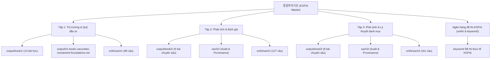

# 증권투자기초 (Kiến Thức Cơ Bản Về Đầu Tư Chứng Khoán Hàn Quốc) — Master Catalog

Master Catalog này là cổng thông tin trung tâm quản lý toàn bộ hệ thống tài liệu học tập, chuyên khảo lý thuyết, ngân hàng câu hỏi đề thi và cẩm nang phân tích tài chính phục vụ các kỳ thi cấp chứng chỉ chuyên môn tài chính của **Hiệp hội Đầu tư Tài chính Hàn Quốc (KOFIA - Korea Financial Investment Association / 금융투자협회)**.

---

## 1. Tổng quan hệ thống chứng chỉ KOFIA (금융투자협회 자격제도)

Hiệp hội Đầu tư Tài chính Hàn Quốc (KOFIA) là tổ chức tự quản nghề nghiệp chịu trách nhiệm quản lý, đào tạo và tổ chức các kỳ thi sát hạch tiêu chuẩn cho nhân lực ngành dịch vụ đầu tư tài chính và thị trường vốn theo **Đạo luật về Dịch vụ Đầu tư Tài chính và Thị trường Vốn Hàn Quốc (자본시장과 금융투자업에 관한 법률 - gọi tắt là 자본시장법 / Capital Markets Act)**.

Trong hệ thống chứng chỉ của KOFIA, hai văn bằng cơ sở quan trọng nhất dành cho người hành nghề tư vấn trung gian là:

1. **증권투자권유대행인 (Đại lý tư vấn đầu tư chứng khoán / Certified Securities Investment Solicitation Broker):** Chứng chỉ cấp quyền chào mời, giải thích và tư vấn các sản phẩm chứng khoán (cổ phiếu, trái phiếu, chứng quyền, công cụ nợ, sản phẩm phái sinh niêm yết tiêu chuẩn) cho khách hàng cá nhân và tổ chức.
2. **펀드투자권유대행인 (Đại lý tư vấn đầu tư chứng chỉ quỹ / Certified Fund Investment Solicitation Broker):** Chứng chỉ cấp quyền chào mời, tư vấn các sản phẩm quỹ đầu tư tập thể (quỹ mở, quỹ đóng, ETF, quỹ bất động sản, quỹ đầu tư phái sinh) do các công ty quản lý tài sản phát hành.

### 1.1. So sánh cơ cấu đề thi và tiêu chuẩn đạt

Cả hai kỳ thi đều áp dụng hình thức thi trắc nghiệm khách quan 4 lựa chọn (객관식 4지 선다형) với thời gian làm bài **120 phút**, tổng cộng **100 câu hỏi**.

| Hạng mục | Chứng chỉ 증권투자권유대행인 | Chứng chỉ 펀드투자권유대행인 |
|---|---|---|
| Hình thức thi | Trắc nghiệm 4 lựa chọn (객관식 4지선다) | Trắc nghiệm 4 lựa chọn (객관식 4지선다) |
| Thời gian làm bài | 120 phút (2 giờ) | 120 phút (2 giờ) |
| Tổng số câu hỏi | 100 câu | 100 câu |
| Số lượng môn thi | 3 môn | 3 môn |
| Điểm sàn chống liệt (과락) | Tối thiểu 40% số điểm mỗi môn | Tối thiểu 40% số điểm mỗi môn |
| Tiêu chuẩn đỗ (최종합격) | Tổng điểm từ 60/100 câu trở lên (từ 60%) | Tổng điểm từ 60/100 câu trở lên (từ 60%) |

#### Cơ cấu chi tiết môn thi 증권투자권유대행인 (Đại lý tư vấn đầu tư chứng khoán)

| Môn thi | Nội dung chi tiết cấu phần | Số câu | Ngưỡng điểm liệt (< 40%) |
|---|---|---|---|
| **Môn 1:** Phân tích chứng khoán & Thị trường | Kinh tế vĩ mô (4 câu), Phân tích cơ bản (3 câu), Phân tích kỹ thuật (3 câu), Thị trường KOSPI (8 câu), Thị trường KOSDAQ (3 câu), Thị trường trái phiếu (7 câu), Thị trường khác (2 câu) | 30 câu | Dưới 12 câu |
| **Môn 2:** Sản phẩm tài chính & Đạo đức | Phân tích sản phẩm tài chính & Chiến lược (23 câu), Tư vấn đầu tư & Quản lý khách hàng (12 câu), Đạo đức nghề nghiệp & Phòng ngừa tranh chấp (15 câu) | 50 câu | Dưới 20 câu |
| **Môn 3:** Pháp luật & Quy chế | Luật Thị trường vốn và các văn bản quy định liên quan, kèm Luật Bảo vệ người tiêu dùng tài chính (금융소비자보호법) | 20 câu | Dưới 8 câu |
| **Tổng cộng** | Toàn bộ 3 môn thi sát hạch | **100 câu** | **Đỗ: Tổng $\ge 60$ câu và không môn nào liệt** |

#### Cơ cấu chi tiết môn thi 펀드투자권유대행인 (Đại lý tư vấn chứng chỉ quỹ)

| Môn thi | Nội dung chi tiết cấu phần | Số câu | Ngưỡng điểm liệt (< 40%) |
|---|---|---|---|
| **Môn 1:** Tư vấn đầu tư, Pháp luật & Đạo đức | Pháp luật & Bảo vệ người tiêu dùng (13 câu), Đạo đức nghề nghiệp & Phòng ngừa tranh chấp (14 câu), Nghiệp vụ bán quỹ (8 câu), Kỹ năng tư vấn đầu tư (15 câu) | 50 câu | Dưới 20 câu |
| **Môn 2:** Đầu tư quỹ & Quản trị | Bản chất & Cấu trúc quỹ (16 câu), Đánh giá quỹ đầu tư (4 câu), Quản trị đầu tư và danh mục (10 câu) | 30 câu | Dưới 12 câu |
| **Môn 3:** Quỹ bất động sản | Pháp luật quỹ bất động sản (5 câu), Nghiệp vụ thực hành quỹ bất động sản (15 câu) | 20 câu | Dưới 8 câu |
| **Tổng cộng** | Toàn bộ 3 môn thi sát hạch | **100 câu** | **Đỗ: Tổng $\ge 60$ câu và không môn nào liệt** |

### 1.2. Địa vị pháp lý và giới hạn hành vi theo Luật Thị trường Vốn (자본시장법)

Theo Điều 51 của Luật Thị trường Vốn Hàn Quốc, Đại lý tư vấn đầu tư (투자권유대행인) là người không thuộc biên chế nhân viên chính thức của công ty chứng khoán/quản lý tài sản, hoạt động dựa trên hợp đồng đại lý ký kết với một tổ chức tài chính.

Quy định pháp lý đặt ra **5 giới hạn nghiêm ngặt** mang tính sống còn mà thí sinh bắt buộc phải nắm vững:

1. **Nguyên tắc độc quyền một công ty (1사 전속주의):** Đại lý tư vấn đầu tư chỉ được giao kết hợp đồng đại lý với một công ty kinh doanh đầu tư tài chính duy nhất tại một thời điểm. Không được phép làm đại lý chào mời song song cho hai công ty đối thủ cùng một loại hình sản phẩm.
2. **Cấm trực tiếp nhận tiền hoặc tài sản của khách hàng (고객 금전·증권 수령 금지):** Đại lý hoàn toàn không được phép cầm tiền mặt, séc, sổ tiết kiệm, tài khoản hay chứng khoán của khách hàng dưới bất kỳ hình thức nào. Toàn bộ dòng tiền phải được khách hàng nộp trực tiếp vào tài khoản mở tại tổ chức tài chính được cấp phép.
3. **Cấm nhận ủy thác đặt lệnh hoặc đại diện giao dịch (주문 대리 및 일임매매 금지):** Đại lý chỉ thực hiện hành vi tư vấn, giải thích sản phẩm (투자권유). Quyết định giao dịch và thao tác đặt lệnh phải do chính khách hàng thực hiện. Đại lý không được phép giữ tài khoản, mật khẩu OTP để đặt lệnh thay.
4. **Cấm cam kết bù trừ thua lỗ hoặc đảm bảo mức sinh lời (손실보전 및 이익보장 약속 금지 - Điều 55):** Nghiêm cấm mọi hành vi hứa hẹn chia sẻ rủi ro, cam kết hoàn vốn hoặc bảo đảm một mức lợi nhuận cố định để lôi kéo khách hàng ký hợp đồng.
5. **Cấm sử dụng thông tin nội bộ chưa công bố (미공개중요정보 이용 금지 - Điều 174):** Nghiêm cấm việc thu thập hoặc rò rỉ các thông tin nội bộ của doanh nghiệp niêm yết để tư vấn trục lợi trước khi thông tin được công bố chính thức ra thị trường.

*Phân biệt với Nhân viên tư vấn chuyên trách (투자권유자문인력):* Nhân viên chuyên trách là nhân sự chính thức của tổ chức tài chính, có thẩm quyền rộng hơn (được ký hợp đồng, xử lý nghiệp vụ tài khoản), trong khi Đại lý tư vấn (대행인) chỉ dừng lại ở phạm vi chào mời và giới thiệu sản phẩm.

---

## 2. Bản đồ học tập & Điều hướng toàn diện (Master Navigation Map)

Kho lưu trữ `증권투자기초/` được thiết kế theo mô hình chuẩn hóa 3 lớp:
- **Lớp Nguồn gốc (Provenance & Raw):** Giữ nguyên văn bản gốc OCR từ 3 cuốn giáo trình chuẩn của KOFIA (`raw_md/` và `raw/`).
- **Lớp Chuyên khảo (Learning Route & Outputs):** Tái cấu trúc thành các bài học chuyên sâu theo quy chuẩn 4 lớp kiến thức: *Bản chất (What) $\rightarrow$ Cơ chế (Why/Mechanism) $\rightarrow$ Ứng dụng (Application) $\rightarrow$ Giới hạn/Ngoại lệ (Boundary)*.
- **Lớp Ngân hàng đề thi (Practice & Exam Bank):** Trọn bộ 377 câu hỏi bài tập kèm lời giải chi tiết song ngữ Hàn - Việt và đề thi online thực tế.

### 2.1. Tập 1 (Book 1 / sach1): Kiến thức thị trường tài chính, cổ phiếu và công cụ nợ

Tập 1 trang bị nền tảng pháp lý, cấu trúc thị trường chứng khoán Hàn Quốc và nguyên lý của quỹ đầu tư tập thể.

- **Cổng điều hướng tổng quan:** [01-book1-securities-investment-foundations.md](./output/01-book1-securities-investment-foundations.md)
- **Mục lục chi tiết 13 chuyên đề:** [output/book1/00-book1-index.md](./output/book1/00-book1-index.md)
- **Hướng dẫn đọc thuật ngữ tiếng Hàn chuyên ngành:** [output/book1/00-korean-reading-guide.md](./output/book1/00-korean-reading-guide.md)
- **Nội dung Chương 1 — Thị trường tài chính & Thị trường chứng khoán (금융시장과 증권시장):**
  * Bài 01: [Tài chính và thị trường chứng khoán](./output/book1/01-financial-markets-and-securities.md) — Dòng tiền, thị trường vốn vs thị trường tiền tệ, thị trường sơ cấp vs thứ cấp.
  * Bài 02: [Các loại và ý nghĩa của chứng khoán](./output/book1/02-securities-types-and-meaning.md) — Phân loại chứng khoán vốn, nợ và chứng khoán phái sinh.
  * Bài 03: [Cấu trúc thị trường chứng khoán](./output/book1/03-securities-market-structure.md) — Thị trường KOSPI, KOSDAQ, KONEX, K-OTC và hệ thống giao dịch thay thế NXT ATS.
  * Bài 04: [Các tổ chức liên quan](./output/book1/04-securities-institutions.md) — Sở giao dịch KRX, Viện lưu ký KSD, Ủy ban Dịch vụ Tài chính FSC, Cơ quan Giám sát Tài chính FSS.
  * Bài 05: [IPO, tăng vốn và niêm yết](./output/book1/05-ipo-and-listing.md) — Chào bán công khai, tăng vốn có trả tiền/không trả tiền, tiêu chuẩn niêm yết.
  * Bài 06: [Giao dịch cổ phiếu và thị trường lưu thông](./output/book1/06-stock-market-trading.md) — Khớp lệnh định kỳ, khớp lệnh liên tục, các loại lệnh giao dịch, biên độ giá $\pm 30\%$.
  * Bài 07: [Hợp đồng tương lai và quyền chọn cơ sở](./output/book1/07-index-futures-options.md) — Chỉ số KOSPI 200, hợp đồng tương lai, quyền chọn và chứng quyền ELW.
  * Bài 08: [Thuế liên quan đến chứng khoán](./output/book1/08-securities-tax.md) — Thuế giao dịch chứng khoán, thuế thu nhập cổ tức, thuế chuyển nhượng vốn.
  * Bài 09: [M&A và thay đổi quyền kiểm soát](./output/book1/09-ma.md) — Chào mua công khai, quyền bảo vệ cổ đông thiểu số, thâu tóm và sáp nhập.
- **Nội dung Chương 2 — Quỹ đầu tư tập thể (집합투자):**
  * Bài 10: [Khái niệm đầu tư tập thể](./output/book1/10-collective-investment-concepts.md) — Pooling tài sản, ủy thác chuyên nghiệp, đa dạng hóa rủi ro.
  * Bài 11: [Cấu trúc quỹ và các chủ thể](./output/book1/11-fund-structure.md) — Công ty quản lý tài sản, công ty bán quỹ, tổ chức ủy thác/lưu ký, công ty quản trị hành chính.
  * Bài 12: [Các loại quỹ](./output/book1/12-fund-types.md) — Quỹ cổ phiếu, quỹ trái phiếu, quỹ hỗn hợp, MMF, ETF và quỹ bất động sản.
  * Bài 13: [Quản lý quỹ](./output/book1/13-fund-management.md) — Khẩu vị rủi ro, định giá NAV, mua/bán lại chứng chỉ quỹ và phí dịch vụ.
  * Ôn tập và nguồn đối chiếu: [output/book1/90-review-and-source-trace.md](./output/book1/90-review-and-source-trace.md)

### 2.2. Tập 2 (Book 2 / sach2): Phân tích cơ bản, phân tích kỹ thuật và định giá chứng khoán

Tập 2 cung cấp bộ công cụ toàn diện về phân tích vĩ mô, định giá doanh nghiệp, đồ thị kỹ thuật và công cụ thu nhập cố định (trái phiếu).

- **Cổng thông tin Sách 2:** [output/book2/README.md](./output/book2/README.md)
- **Hồ sơ kiểm định & Provenance:** [sach2/README.md](./sach2/README.md) · [SOURCE_COVERAGE_BOOK2.md](./sach2/SOURCE_COVERAGE_BOOK2.md) · [FORMULA_TABLE_FIGURE_AUDIT_BOOK2.md](./sach2/FORMULA_TABLE_FIGURE_AUDIT_BOOK2.md)
- **Lộ trình 6 chuyên đề chuyên sâu:**
  1. [Phân tích kinh tế vĩ mô, ngành và báo cáo tài chính](./output/book2/01_SECURITIES_MACRO_AND_FINANCIAL_ANALYSIS.md) — Chu kỳ kinh tế (Kitchin, Juglar, Kondratiev), chỉ số CSI/BSI, bảng cân đối kế toán, báo cáo kết quả kinh doanh và báo cáo lưu chuyển tiền tệ.
  2. [Định giá cổ phiếu: Dòng tiền, CAPM và bội số Multiples](./output/book2/02_EQUITY_VALUATION_AND_MULTIPLES.md) — Mô hình DDM, Gordon Growth, FCFF/FCFE, WACC, EVA, PER, PBR, PSR, EV/EBITDA.
  3. [Phân tích kỹ thuật: Mô hình giá, nến Nhật và chỉ báo](./output/book2/03_TECHNICAL_ANALYSIS.md) — Lý thuyết Dow, sóng Elliott, nến đảo chiều Nhật Bản, đường MA, RSI, MACD, Bollinger Bands, Stochastic, OBV, VR.
  4. [Chiến lược đầu tư, đa dạng hóa và chỉ số giá cổ phiếu](./output/book2/04_INVESTMENT_STRATEGIES_AND_INDICES.md) — Danh mục 2 tài sản, chỉ số bình quân giá (Price-weighted) vs giá trị vốn hóa (Market-cap weighted).
  5. [Trái phiếu và công cụ thu nhập cố định](./output/book2/05_BONDS_AND_FIXED_INCOME_INSTRUMENTS.md) — Trái phiếu chuyển đổi (CB), trái phiếu kèm chứng quyền (BW), trái phiếu hoán đổi (EB), ABS, MBS, CMO, FRN.
  6. [Lợi suất trái phiếu, cấu trúc kỳ hạn, Duration và chỉ số](./output/book2/06_BOND_YIELDS_RISK_DURATION_AND_INDICES.md) — YTM, Current Yield, Spot/Forward Rates, Macaulay Duration, Modified Duration, Convexity, Giao dịch Repo và Haircut.

### 2.3. Tập 3 (Book 3 / sach3): Thị trường phái sinh, lý thuyết danh mục và quản trị rủi ro

Tập 3 tập trung vào lý thuyết tài chính định lượng hiện đại, quản lý danh mục Markowitz, thị trường phái sinh (Futures, Options, Swaps) và sản phẩm cấu trúc OTC.

- **Cổng thông tin Sách 3:** [output/book3/README.md](./output/book3/README.md)
- **Hồ sơ kiểm định & Provenance:** [sach3/README.md](./sach3/README.md) · [SOURCE_COVERAGE_BOOK3.md](./sach3/SOURCE_COVERAGE_BOOK3.md) · [FORMULA_TABLE_FIGURE_AUDIT_BOOK3.md](./sach3/FORMULA_TABLE_FIGURE_AUDIT_BOOK3.md)
- **Lộ trình 8 chuyên đề chuyên sâu:**
  1. [Thống kê tài chính cho đầu tư](./output/book3/01_PORTFOLIO_STATISTICS.md) — Kỳ vọng, phương sai, hiệp phương sai, hệ số tương quan, hồi quy OLS.
  2. [Lý thuyết danh mục và phân tán rủi ro](./output/book3/02_PORTFOLIO_THEORY.md) — Đường biên hiệu quả Markowitz (Efficient Frontier), hàm hữu dụng, danh mục phương sai tối thiểu (MVP), đường CAL.
  3. [Mô hình CAPM và thị trường hiệu quả](./output/book3/03_CAPM_AND_EFFICIENT_MARKETS.md) — Đường CML, hệ số Beta ($\beta$), đường SML, giả thuyết thị trường hiệu quả (EMH: yếu, bán mạnh, mạnh) và Market Anomalies.
  4. [Đo lường thành quả đầu tư và định giá](./output/book3/04_PERFORMANCE_AND_VALUATION.md) — Lợi suất bình quân trọng số tiền tệ (MWR) vs thời gian (TWR), chỉ số Sharpe, Treynor, Jensen's Alpha, mô hình DCF và EVA.
  5. [Nền tảng phái sinh và sản phẩm theo chỉ số](./output/book3/05_DERIVATIVES_FOUNDATIONS_AND_INDEX_PRODUCTS.md) — Hợp đồng tương lai, quyền chọn, mô hình Cost of Carry, định nghĩa Basis, ký quỹ phái sinh, quan hệ Put-Call Parity, các hệ số nhạy cảm Greeks ($\Delta, \Gamma, \Theta, \text{Vega}, \rho$).
  6. [Phái sinh lãi suất, tiền tệ, tín dụng và hàng hóa](./output/book3/06_RATES_CURRENCY_CREDIT_COMMODITY_DERIVATIVES.md) — Kỳ hạn lãi suất IFR, hoán đổi lãi suất IRS, ngang giá lãi suất CIP/UIP, hợp đồng hoán đổi rủi ro tín dụng CDS, Contango và Backwardation.
  7. [Phái sinh OTC và chứng khoán cấu trúc](./output/book3/07_OTC_DERIVATIVES_AND_STRUCTURED_SECURITIES.md) — Giao dịch OTC, sản phẩm liên kết cổ phiếu ELS/ELB, sản phẩm liên kết phái sinh DLS/DLB, cơ chế rào cản Knock-in / Knock-out và Auto-callable stepdown.
  8. [Phòng thực hành tình huống tích hợp](./output/book3/08_INTEGRATED_CASE_LAB.md) — Tình huống thực tế kết nối CAPM, định giá DCF, phòng hộ phái sinh và phân tích kịch bản căng thẳng (Stress test).

### 2.4. Ngân hàng câu hỏi trắc nghiệm song ngữ (`onthi/` & `keyword/`)

Kho tài liệu cung cấp hệ thống 377 câu hỏi nguyên bản kèm đáp án và phân tích chi tiết:

- **Bộ đề Tập 1 (89 câu):**
  * Văn bản gốc trắc nghiệm: [onthi/sach1_89_cau_hoi_goc.md](./onthi/sach1_89_cau_hoi_goc.md)
  * Bản in giải thích song ngữ: [onthi/sach1_89_cau_hoi_giai_thich_song_ngu.pdf](./onthi/sach1_89_cau_hoi_giai_thich_song_ngu.pdf)
  * Ứng dụng web luyện thi tương tác: [onthi/sach1_luyen_tap_89_cau.html](./onthi/sach1_luyen_tap_89_cau.html)
- **Bộ đề Tập 2 (127 câu):**
  * Toàn văn câu hỏi & lựa chọn: [onthi/sach2_127_cau_hoi_va_lua_chon.md](./onthi/sach2_127_cau_hoi_va_lua_chon.md)
  * Bản in tiết kiệm giải thích KR-VI: [onthi/sach2_127_cau_hoi_giai_thich_KR_VI_in_tiet_kiem.pdf](./onthi/sach2_127_cau_hoi_giai_thich_KR_VI_in_tiet_kiem.pdf)
- **Bộ đề Tập 3 (161 câu):**
  * Toàn tập 161 câu giải thích song ngữ chi tiết: [onthi/sach3_161_questions_bilingual_explanations.md](./onthi/sach3_161_questions_bilingual_explanations.md)
  * Bản đính chính đáp án chuẩn hóa: [onthi/sach3_questions_corrected_161.md](./onthi/sach3_questions_corrected_161.md)
  * Đề luyện tập tổng hợp: [onthi/sach3_all_practice_questions.md](./onthi/sach3_all_practice_questions.md)
- **Ngân hàng đề thi thực tế chuẩn hóa KOFIA:**
  * Bộ đề thi trắc nghiệm thực chiến: [keyword/증권투가기초(thi) 3b16d08c711180799844cf8322a03526.md](./keyword/%EC%A6%9D%EA%B6%8C%ED%88%AC%EA%B0%80%EA%B8%B0%EC%B4%88%28thi%29%203b16d08c711180799844cf8322a03526.md)

---

## 3. Bảng công thức tính toán tài chính trọng tâm (Core Financial Formulas)

Dưới đây là các công thức toán học và tài chính định lượng then chốt thường xuyên xuất hiện trong các bài toán tính toán của đề thi KOFIA.

### 3.1. Nhóm chỉ số phân tích cổ phiếu và khả năng sinh lời

#### 1. Lợi nhuận trên mỗi cổ phần (Earnings Per Share - EPS / 주당순이익)
$$\text{EPS} = \frac{\text{Lợi nhuận sau thuế} - \text{Cổ tức cổ phiếu ưu đãi}}{\text{Số lượng cổ phiếu phổ thông bình quân lưu hành}}$$

#### 2. Bội số giá trên lợi nhuận (Price-to-Earnings Ratio - PER / 주가수익비율)
$$\text{PER} = \frac{\text{Giá thị trường mỗi cổ phiếu } (P)}{\text{Lợi nhuận trên mỗi cổ phiếu } (\text{EPS})}$$

*Mối liên hệ với Mô hình tăng trưởng Gordon:*
$$\text{PER} = \frac{\frac{D_1}{\text{EPS}}}{k - g} = \frac{\text{Tỷ lệ chi trả cổ tức } (b)}{k - g}$$
Trong đó:
- $b$: Tỷ lệ chi trả cổ tức (Dividend Payout Ratio).
- $k$: Tỷ suất sinh lợi đòi hỏi của vốn chủ sở hữu (Required Rate of Return).
- $g$: Tốc độ tăng trưởng cổ tức dài hạn ($g = \text{ROE} \times (1 - b)$).

#### 3. Bội số giá trên giá trị sổ sách (Price-to-Book Ratio - PBR / 주가순자산비율)
$$\text{PBR} = \frac{\text{Giá thị trường mỗi cổ phiếu } (P)}{\text{Giá trị sổ sách mỗi cổ phiếu } (\text{BPS})}$$

*Mối quan hệ liên thông cốt lõi giữa PBR, PER và ROE:*
$$\text{PBR} = \frac{P}{\text{BPS}} = \frac{P}{\text{EPS}} \times \frac{\text{EPS}}{\text{BPS}} = \text{PER} \times \text{ROE}$$

#### 4. Tỷ suất sinh lợi trên vốn chủ sở hữu (Return on Equity - ROE / 자기자본이익률) & Phân tích DuPont
$$\text{ROE} = \frac{\text{Lợi nhuận sau thuế}}{\text{Vốn chủ sở hữu bình quân}}$$

*Mô hình phân rã DuPont 3 nhân tố:*
$$\text{ROE} = \underbrace{\frac{\text{Lợi nhuận sau thuế}}{\text{Doanh thu}}}_{\text{Biên lợi nhuận ròng (Net Profit Margin)}} \times \underbrace{\frac{\text{Doanh thu}}{\text{Tổng tài sản}}}_{\text{Vòng quay tài sản (Asset Turnover)}} \times \underbrace{\frac{\text{Tổng tài sản}}{\text{Vốn chủ sở hữu}}}_{\text{Đòn bẩy tài chính (Equity Multiplier)}}$$

#### 5. Mô hình chiết khấu cổ tức tăng trưởng đều Gordon (Gordon Dividend Growth Model)
$$P_0 = \frac{D_1}{k - g} = \frac{D_0 (1 + g)}{k - g} \quad (k > g)$$

#### 6. Mô hình định giá tài sản vốn CAPM (Capital Asset Pricing Model)
$$E(R_i) = R_f + \beta_i \left[ E(R_m) - R_f \right]$$
Trong đó hệ số rủi ro hệ thống $\beta_i$ được tính bằng:
$$\beta_i = \frac{\text{Cov}(R_i, R_m)}{\sigma_m^2} = \rho_{im} \frac{\sigma_i}{\sigma_m}$$

---

### 3.2. Nhóm định giá trái phiếu, rủi ro lãi suất và Duration

#### 1. Định giá trái phiếu tổng quát (Bond Valuation)
$$P = \sum_{t=1}^n \frac{C}{(1+y)^t} + \frac{F}{(1+y)^n}$$
Trong đó:
- $C$: Khoản thanh toán lãi định kỳ (Coupon).
- $F$: Mệnh giá trái phiếu (Face value).
- $y$: Lợi suất đáo hạn (Yield to Maturity - YTM).
- $n$: Số kỳ hạn còn lại cho đến khi đáo hạn.

#### 2. Lợi suất hiện hành (Current Yield / 직접수익률)
$$\text{Current Yield} = \frac{\text{Lãi cuống phiếu hàng năm } (C)}{\text{Giá thị trường hiện tại của trái phiếu } (P)}$$

#### 3. Thời lượng Macaulay (Macaulay Duration / 맥컬리 듀레이션)
Macaulay Duration đo lường thời gian hòa vốn bình quân trọng số của các dòng tiền trái phiếu:
$$D_{\text{Mac}} = \frac{\sum_{t=1}^n \frac{t \cdot C_t}{(1+y)^t}}{P}$$
*Đặc tính đặc biệt:* Đối với trái phiếu không trả lãi định kỳ (Zero-coupon bond / 할인채), $D_{\text{Mac}} = n$ (bằng đúng số năm đáo hạn). Đối với trái phiếu có trả lãi (Coupon bond / 이표채), $D_{\text{Mac}} < n$.

#### 4. Thời lượng hiệu chỉnh (Modified Duration / 수정 듀레이션) & Biến động giá
Modified Duration đo lường tỷ lệ phần trăm thay đổi của giá trái phiếu khi lợi suất thị trường biến động 1 điểm phần trăm:
$$D_{\text{mod}} = \frac{D_{\text{Mac}}}{1 + y}$$
*Công thức xấp xỉ mức độ nhạy cảm của giá trái phiếu:*
$$\frac{\Delta P}{P} \approx - D_{\text{mod}} \cdot \Delta y$$

Khi có tính đến Độ lồi (Convexity - $C$), công thức xấp xỉ bậc hai đạt độ chính xác cao hơn:
$$\frac{\Delta P}{P} \approx - D_{\text{mod}} \cdot \Delta y + \frac{1}{2} C \cdot (\Delta y)^2$$

---

### 3.3. Nhóm phái sinh, tỷ lệ phòng hộ và đánh giá danh mục

#### 1. Giá trị lý thuyết của Hợp đồng tương lai (Cost of Carry Model)
$$F_0 = S_0 \left[ 1 + (r - q) T \right]$$
Trong đó:
- $S_0$: Giá giao ngay (Spot price).
- $r$: Lãi suất phi rủi ro (Risk-free rate).
- $q$: Tỷ suất cổ tức / thu nhập tài sản (Dividend yield).
- $T$: Thời gian đến ngày đáo hạn (tính theo năm).

*Định nghĩa Basis (베이시스):*
$$\text{Basis} = \text{Futures Price} - \text{Spot Price}$$
- Nếu $\text{Basis} > 0$: Thị trường bình thường (Contango / 콘탱고).
- Nếu $\text{Basis} < 0$: Thị trường nghịch đảo (Backwardation / 백워데이션).

#### 2. Tỷ lệ phòng hộ tối ưu phương sai tối thiểu (Minimum Variance Hedge Ratio)
$$h^* = \rho_{SF} \frac{\sigma_S}{\sigma_F} = \frac{\text{Cov}(S, F)}{\sigma_F^2}$$

#### 3. Số lượng hợp đồng tương lai phòng hộ danh mục cổ phiếu ($N^*$)
$$N^* = \beta_P \times \frac{V_P}{V_F} = \beta_P \times \frac{V_P}{F \times \text{Multiplier}}$$
Trong đó:
- $V_P$: Tổng giá trị thị trường của danh mục cổ phiếu cần phòng hộ.
- $V_F$: Giá trị danh nghĩa của một hợp đồng tương lai ($F \times \text{Hệ số nhân hợp đồng}$).
- $\beta_P$: Hệ số Beta của danh mục đầu tư.

Nếu nhà đầu tư muốn điều chỉnh Beta danh mục từ $\beta_P$ về mức Beta mục tiêu $\beta_T$:
$$N^* = (\beta_T - \beta_P) \times \frac{V_P}{V_F}$$
- Nếu $\beta_T < \beta_P$: Bán hợp đồng tương lai ($N^* < 0$).
- Nếu $\beta_T > \beta_P$: Mua hợp đồng tương lai ($N^* > 0$).

#### 4. Các chỉ số đo lường hiệu quả hoạt động danh mục đầu tư

| Tên chỉ số | Công thức | Thước đo rủi ro | Ứng dụng phù hợp |
|---|---|---|---|
| **Sharpe Ratio** | $S_P = \frac{R_P - R_f}{\sigma_P}$ | Tổng rủi ro (Độ lệch chuẩn $\sigma_P$) | Đánh giá danh mục chưa đa dạng hóa hoàn toàn |
| **Treynor Ratio** | $T_P = \frac{R_P - R_f}{\beta_P}$ | Rủi ro hệ thống (Hệ số Beta $\beta_P$) | Đánh giá danh mục đã đa dạng hóa tốt |
| **Jensen's Alpha ($\alpha_P$)** | $\alpha_P = R_P - \left[ R_f + \beta_P (R_m - R_f) \right]$ | Lợi nhuận vượt mức kỳ vọng của CAPM | Đánh giá năng lực lựa chọn chứng khoán của nhà quản lý |

---

## 4. Cẩm nang cạm bẫy thi cử KOFIA thường gặp (Exam Pitfalls & Trap Analysis)

Tổng hợp các bẫy đề thi kinh điển từ ngân hàng đề thi KOFIA được đúc kết từ 377 câu hỏi thực tế:

### Cạm bẫy 1: Giới hạn pháp lý của Đại lý tư vấn đầu tư (투자권유대행인)
- **Bẫy "Nhận tiền và lưu ký":** Đề thi thường đưa câu hỏi: *"Đại lý tư vấn có thể trực tiếp nhận tiền gửi từ khách hàng nếu được khách hàng ủy quyền bằng văn bản"* $\rightarrow$ **SAI TUYỆT ĐỐI (X)**. Đại lý tư vấn KHÔNG BAO GIỜ được cầm tiền mặt hay chứng khoán dưới mọi hình thức ủy quyền.
- **Bẫy "Ủy thác đặt lệnh":** *"Để thuận tiện cho nhà đầu tư bận rộn, đại lý tư vấn có thể tiếp nhận chỉ thị và trực tiếp thao tác đặt lệnh trên tài khoản"* $\rightarrow$ **SAI (X)**. Đây là hành vi bị cấm nghiêm ngặt (nhận ủy thác trái phép).
- **Bẫy "Bảo toàn vốn và cam kết lợi nhuận":** Bất kỳ cam kết nào khẳng định *"khoản đầu tư chắc chắn có lãi"* hoặc *"công ty sẽ hỗ trợ bù đắp nếu thua lỗ"* đều là hành vi vi phạm pháp luật nghiêm trọng (Điều 55 Luật Thị trường vốn).

### Cạm bẫy 2: Phân loại hình thức niêm yết (신규상장 vs 신주상장)
- **신규상장 (Niêm yết mới):** Áp dụng cho doanh nghiệp lần đầu tiên đưa toàn bộ cổ phiếu lên sàn giao dịch chứng khoán (thông qua IPO).
- **신주상장 (Niêm yết cổ phiếu mới):** Áp dụng cho doanh nghiệp **ĐÃ NIÊM YẾT SẴN TRÊN SÀN**, sau đó tiến hành tăng vốn có trả tiền (유상증자) hoặc tăng vốn không trả tiền (무상증자) và đưa số cổ phiếu mới phát hành thêm này lên sàn.
- *Bẫy đề thi:* Đề thi trắc nghiệm O/X thường hoán đổi: *"신규상장 là việc doanh nghiệp đã niêm yết phát hành thêm cổ phiếu do tăng vốn đưa lên sàn"* $\rightarrow$ **Đáp án là X** (phải là 신주상장).

### Cạm bẫy 3: Phân biệt các loại lệnh giao dịch chứng khoán
- **지정가주문 (Lệnh giới hạn - Limit Order):** Lệnh chỉ được khớp tại mức giá chỉ định hoặc mức giá có lợi hơn:
  * Khi Mua: Khớp ở giá $\le$ giá chỉ định.
  * Khi Bán: Khớp ở giá $\ge$ giá chỉ định.
  * *Bẫy:* Lệnh giới hạn không đảm bảo khớp hết khối lượng ngay lập tức nếu thị trường không có mức giá thỏa mãn.
- **시장가주문 (Lệnh thị trường - Market Order):** Khớp ngay lập tức với khối lượng tối đa tại các mức giá tốt nhất đang treo trên sổ lệnh. Chấp nhận trượt giá để ưu tiên khớp về thời gian.
- **조건부지정가주문 (Lệnh giới hạn có điều kiện):** Trong giờ giao dịch liên tục hoạt động như lệnh giới hạn bình thường. Nếu đến 15:20 (trước phiên khớp lệnh định kỳ đóng cửa) mà chưa khớp thì **tự động chuyển thành lệnh thị trường** để khớp tại giá đóng cửa.
- **최유리지정가주문 (Lệnh giới hạn có lợi nhất):** Đặt mua tại giá chào bán thấp nhất hiện có; đặt bán tại giá chào mua cao nhất hiện có.
- **최우선지정가주문 (Lệnh giới hạn ưu tiên nhất):** Đặt mua tại giá chào mua cao nhất hiện có của bên mua; đặt bán tại giá chào bán thấp nhất hiện có của bên bán (lệnh nằm chờ ở đầu hàng chờ sổ lệnh).

### Cạm bẫy 4: Bóc tách cơ cấu chi phí quỹ đầu tư (보수 vs 수수료)
- **운용보수 (Phí quản lý):** Trả định kỳ (trích theo tỷ lệ % NAV hàng ngày) cho **Công ty quản lý tài sản (자산운용사)** vì công việc ra quyết định đầu tư danh mục.
- **판매보수 (Phí dịch vụ bán quỹ):** Trả định kỳ cho **Công ty bán quỹ (판매회사 - Ngân hàng, CTCK)** để duy trì chăm sóc và tư vấn định kỳ cho nhà đầu tư.
- **판매수수료 (Hoa hồng bán quỹ):** Khoản phí chỉ thu một lần tại thời điểm mua (선취판매수수료 - trả trước) hoặc bán ra (후취판매수수료 - trả sau). Trả cho công ty bán quỹ vì công sức tư vấn phân phối ban đầu.
- **수탁보수 (Phí lưu ký/ủy thác):** Trả định kỳ cho **Ngân hàng ủy thác/lưu ký (신탁업자/수탁회사)** chịu trách nhiệm cất giữ, bảo quản tài sản quỹ tách bạch khỏi công ty quản lý.
- *Bẫy kinh điển:* *"Khoản thù lao chi trả cho công ty quản lý tài sản là hoa hồng bán quỹ (판매수수료)"* $\rightarrow$ **SAI (X)**. Phải là phí quản lý (운용보수).

### Cạm bẫy 5: Ký quỹ và cơ chế xử lý tài khoản phái sinh (Futures Margin)
- **위탁증거금 (Ký quỹ ban đầu / Initial Margin):** Mức ký quỹ tối thiểu nộp khi mở vị thế mới (thường khoảng $15\%$ giá trị hợp đồng).
- **유지증거금 (Ký quỹ duy trì / Maintenance Margin):** Ngưỡng tối thiểu tài khoản phải giữ được để duy trì vị thế qua đêm (thường khoảng $10\%$ giá trị hợp đồng).
- **추가증거금 (Ký quỹ bổ sung / Margin Call):** Khi số dư tài khoản sụt giảm xuống dưới mức ký quỹ duy trì, nhà đầu tư nhận Margin Call và phải nộp thêm tiền:
  * *Bẫy cực lớn:* Số tiền phải nộp thêm là để đưa tài khoản **quay trở lại mức KÝ QUỸ BAN ĐẦU (Initial Margin)**, KHÔNG PHẢI chỉ nộp bù đến mức duy trì!
  * Nếu không nộp đủ trước hạn quy định (12:00 ngày hôm sau), CTCK sẽ thực hiện cưỡng chế đóng vị thế (bán giải chấp).

### Cạm bẫy 6: Quyền và Nghĩa vụ trong Hợp đồng Quyền chọn (Options)
- **Người mua quyền chọn (Option Buyer):** Có **Quyền** thực hiện, **Không có Nghĩa vụ**.
  * Rủi ro thua lỗ tối đa: Giới hạn bằng đúng số phí quyền chọn đã trả (Premium).
  * Lợi nhuận tiềm năng: Vô hạn (với Call) hoặc rất lớn cho đến khi giá về 0 (với Put).
- **Người bán quyền chọn (Option Writer/Seller):** Có **Nghĩa vụ** thực hiện khi đối tác yêu cầu, **Không có Quyền**.
  * Lợi nhuận tối đa: Giới hạn bằng đúng số tiền phí quyền chọn thu được (Premium).
  * Rủi ro thua lỗ: Vô hạn (với Call) hoặc rất lớn (với Put).

### Cạm bẫy 7: Đặc tính của Trái phiếu và Duration
- **Mối quan hệ Giá và Lợi suất:** Luôn biến động **nghịch chiều**. Lợi suất tăng $\implies$ Giá trái phiếu giảm.
- **Thời lượng của Trái phiếu không trả lãi (Zero-coupon bond):** Macaulay Duration bằng đúng thời hạn đáo hạn ($D_{\text{Mac}} = T$).
- **Thời lượng của Trái phiếu có trả lãi (Coupon bond):** Luôn nhỏ hơn thời hạn đáo hạn ($D_{\text{Mac}} < T$).
- **Các yếu tố làm tăng Duration:** Lãi suất coupon càng THẤP, lợi suất thị trường (Yield) càng THẤP, kỳ hạn đáo hạn càng DÀI $\implies$ Duration càng LỚN (độ nhạy cảm giá trước biến động lãi suất càng mạnh).

### Cạm bẫy 8: Đa dạng hóa danh mục: Rủi ro hệ thống vs Rủi ro phi hệ thống
- **Rủi ro phi hệ thống (비체계적 위험 - Unsystematic / Idiosyncratic Risk):** Là rủi ro riêng lẻ gắn liền với nội tại doanh nghiệp (tai nạn, đình công, rủi ro pháp lý, rủi ro tài chính riêng). Loại rủi ro này **HOÀN TOÀN CÓ THỂ TRIỆT TIÊU** bằng cách tăng số lượng cổ phiếu trong danh mục ($N \ge 30$) hoặc chọn các tài sản có hệ số tương quan thấp/âm.
- **Rủi ro hệ thống (체계적 위험 - Systematic / Market Risk):** Là rủi ro toàn thị trường bắt nguồn từ các biến động kinh tế vĩ mô (lãi suất, lạm phát, suy thoái kinh tế, chiến tranh). Loại rủi ro này **KHÔNG BAO GIỜ ĐƯỢC TRIỆT TIÊU** bằng đa dạng hóa thông thường, chỉ có thể đo lường bằng hệ số Beta ($\beta$) và quản trị thông qua các công cụ phái sinh (Futures/Options).
- *Bẫy đề thi:* *"Một danh mục đầu tư nắm giữ hơn 1.000 cổ phiếu khác nhau sẽ xóa bỏ hoàn toàn mọi rủi ro đầu tư"* $\rightarrow$ **SAI (X)** (chỉ xóa được rủi ro phi hệ thống, rủi ro hệ thống vẫn giữ nguyên).

---

## 5. Hướng dẫn lộ trình ôn tập và chiến lược thi đỗ KOFIA

Để đạt kết quả tối ưu trong kỳ thi sát hạch KOFIA, thí sinh nên áp dụng lộ trình ôn tập 3 giai đoạn:

1. **Giai đoạn 1 — Xây dựng nền tảng lý thuyết (Tuần 1–3):**
   - Đọc tuần tự các bài học trong [Tập 1](./output/book1/00-book1-index.md), [Tập 2](./output/book2/README.md) và [Tập 3](./output/book3/README.md).
   - Tra cứu thuật ngữ chuyên ngành tiếng Hàn qua [Hướng dẫn đọc thuật ngữ](./output/book1/00-korean-reading-guide.md).
   - Nắm chắc cơ chế các công cụ tài chính và quy định pháp lý cơ bản của 자본시장법.
2. **Giai đoạn 2 — Rèn luyện phản xạ tính toán và bẫy đề thi (Tuần 4–5):**
   - Làm chủ toàn bộ công thức tại **Mục 3 (Bảng công thức tài chính trọng tâm)**.
   - Ôn tập kỹ **Mục 4 (Cẩm nang cạm bẫy thi cử)** để tránh mất điểm ở các câu hỏi lừa chữ O/X.
   - Hoàn thành bài tập trắc nghiệm từng phần:
     * 89 câu Tập 1 ([sach1_89_cau_hoi_goc.md](./onthi/sach1_89_cau_hoi_goc.md))
     * 127 câu Tập 2 ([sach2_127_cau_hoi_va_lua_chon.md](./onthi/sach2_127_cau_hoi_va_lua_chon.md))
     * 161 câu Tập 3 ([sach3_161_questions_bilingual_explanations.md](./onthi/sach3_161_questions_bilingual_explanations.md))
3. **Giai đoạn 3 — Luyện đề tổng hợp thực chiến (Tuần 6):**
   - Thực hành giải trọn vẹn bộ đề thi thực tế tại [keyword/증권투가기초(thi) 3b16d08c711180799844cf8322a03526.md](./keyword/%EC%A6%9D%EA%B6%8C%ED%88%AC%EA%B0%80%EA%B8%B0%EC%B4%88%28thi%29%203b16d08c711180799844cf8322a03526.md).
   - Bấm giờ 120 phút làm trọn vẹn 100 câu, kiểm tra xem có môn nào dưới $40\%$ hay không và tổng điểm có vượt ngưỡng $60\%$ an toàn.
